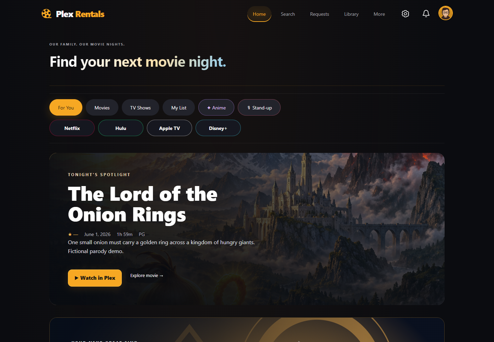
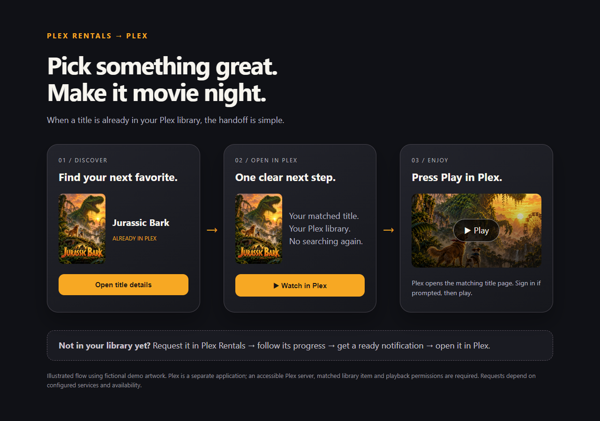
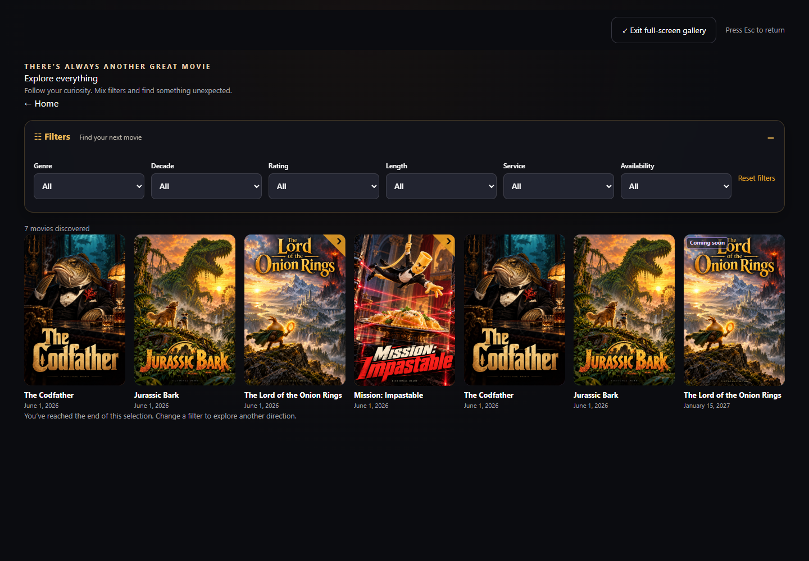
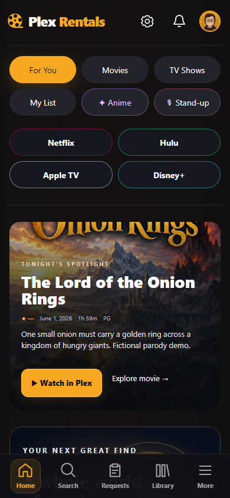
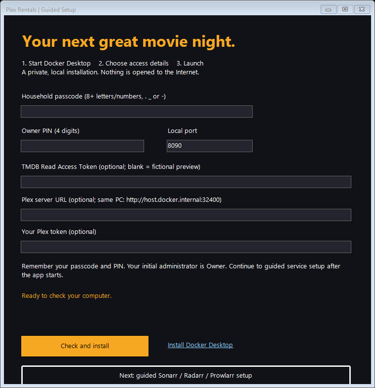
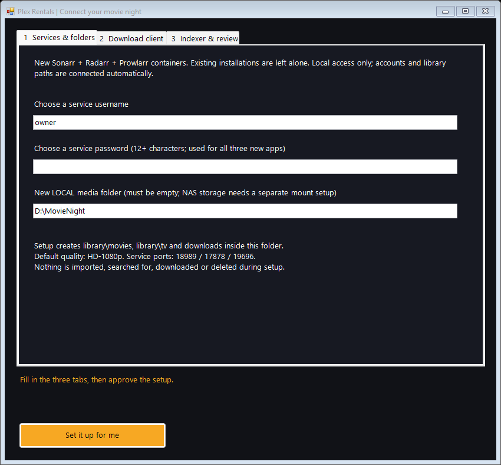
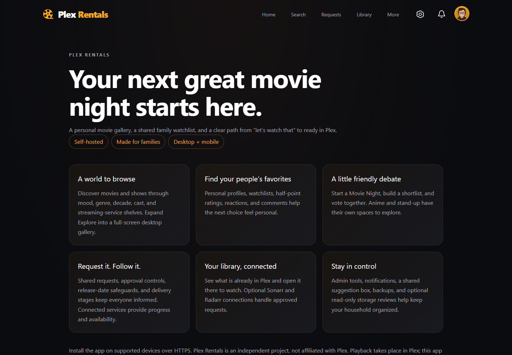

<div align="center">


**A self-hosted discovery and request hub for your household’s Plex library.**

[Get started](#get-started-on-windows) · [Explore the features](#one-place-for-movie-night) · [Setup guide](SETUP.md) · [Security](SECURITY.md)

Browse something great. Request it together. Know when it’s ready.

</div>



## One place for movie night

| Discover | Make it yours | Bring everyone together |
|---|---|---|
| Search movies, TV, and people | Personal profiles and watchlists | Movie Night shortlists and voting |
| Filter by genre, decade, rating, runtime, and service | Reactions and personalized recommendations | Shared requests and “me too” support |
| Immersive desktop **full-screen gallery** | Normal or locally pixelated profile photos | Half-point ratings on a 10-point scale |
| Dedicated Anime and Stand-up spaces | Poster badges for availability and requests | Comments, mentions, and notifications |
| Upcoming releases and full release dates | Adjustable effects and reduced motion | Shared suggestions with admin review |

### From “let’s watch that” to ready in Plex

Plex library matching shows what you already have. Optional Sonarr and Radarr connections can dispatch approved requests and report download progress, estimated speed, ETA, import status, and Plex confirmation. Playback opens in Plex.



- **Household controls:** passcode access, profile PINs, a separate admin unlock, and rating restrictions.
- **Request controls:** up to 10 new requests per profile per Central-time calendar day are automatically approved; further requests enter admin review. Service dispatch must be configured and enabled separately.
- **Release safeguards:** new movies wait for a qualifying home-release date; older movies have a fallback when metadata is incomplete.
- **Admin command center:** statuses, bulk approval, request history, integration tests, and library-match review.
- **Storage review:** optional read-only library inventory, largest items first, and a review-list export. The storage dashboard does not delete files.
- **Optional rentals:** a separately configured seven-day movie lifecycle. Expiry can delete a qualifying newly acquired movie through Radarr; enable only after reviewing the rules and backups.
- **Care and recovery:** SQLite backups, persisted Docker volumes, and clear service health checks.

## A gallery that fills your screen

Open **Explore everything → Full-screen gallery** on desktop. Filters and movie details keep working; click **Exit full-screen gallery** or press **Esc** to return. Browsers without fullscreen support still get a wide gallery layout.



## Comfortable on a phone

Touch-friendly navigation, compact filter rows, a profile photo editor, and a responsive catalog make browsing work from the couch. With HTTPS, supported browsers can install the PWA; push notifications need additional configuration and browser support. The offline shell does not cache movies for playback.

<p align="center"></p>

## Get started on Windows

1. Download the [**Windows setup + source package (v0.2.0 preview)**](https://github.com/aaust27/plex-rentals/raw/refs/heads/main/Plex-Rentals-Windows-Setup-v0.2.0-preview.zip). [SHA-256 checksum](SHA256SUMS-v0.2.0.txt).
2. Extract it into a folder you plan to keep. The wizard can download and open the verified official installer for [Docker Desktop with Linux containers](https://docs.docker.com/desktop/setup/install/windows-install/).
3. Double-click **Start Setup.cmd**. Choose a household passcode, a four-digit Owner PIN, and an unused local port. TMDB and Plex connection fields are optional for the first preview.
4. Click **Check and install**. Setup checks Docker and the port, builds the app, waits for health, and opens your browser.
5. Click **Next: guided Sonarr / Radarr / Prowlarr setup** for the optional three-tab service wizard. Choose a new local media folder and service login; optionally enter qBittorrent and Torznab details. Review the permission checkbox, then click **Set it up for me**.
6. Sign in using your household passcode and the **Owner** profile. Follow the [connection checklist](SETUP.md) to add real catalog data and your Plex server.

The installer is an inspectable PowerShell wizard, not a signed EXE. It requires an Internet connection for Docker build dependencies. Docker installation is opt-in: the wizard verifies the official installer signature and opens its interactive setup; you review licensing, Windows prompts and any restart. It never reboots Windows automatically. Keep the extracted installation folder and its private `.env` for updates.





**Safe initial scope:** localhost only. Optional guided services create separate local config volumes, generate new private API keys, create movie/TV roots and HD-1080p profiles, and connect Prowlarr to Sonarr/Radarr. Optional client/indexer connections are tested and saved disabled. No NAS mounts, public tunnel or downloads are started. A blank TMDB token opens a fictional preview catalog. Docker must keep running for the app to work.

## What you bring

| Connection | What it adds |
|---|---|
| TMDB account + Read Access Token | Real movie/TV metadata, search, artwork, and discovery |
| Your Plex server | Existing-library availability and links to playback |
| Sonarr / Radarr, optional | Approved-request dispatch and delivery tracking |
| Your download client and indexers, optional | Separately configured acquisition infrastructure |
| HTTPS proxy and access policy, optional | Remote access and supported PWA features |

Netflix, Hulu, Apple TV, and Disney+ shelves are discovery filters based on region-specific provider metadata. They do not provide subscriptions or playback from those services. No movies, indexer accounts, download credentials, or media subscriptions are included.

## About the project

Plex Rentals puts a family-friendly interface in front of a self-hosted library: fewer separate tools to explain, more time choosing something together. The included About page introduces the experience inside the app.



Built with React, TypeScript, Vite, Express, SQLite, and Docker. Internal package names retain `reelrequest` for compatibility. Suggestions are an admin-reviewed feature queue; this distribution does not include an autonomous AI developer or paid AI service.

## Development

The complete application source is included inside the setup ZIP above. Extract that package before following these development commands. Requires Node 24 and pnpm 11.19.0. Building outside Docker also requires a C++ compiler and Python for the SQLite native dependency (on Windows, Visual Studio C++ Build Tools):

```sh
pnpm install --frozen-lockfile
pnpm build
pnpm test
pnpm lint
```

See [SETUP.md](SETUP.md) for Docker start, stop, update, and backup instructions. Do not commit `.env`, databases, screenshots of real accounts, or media inventories.

All screenshots above use an isolated fictional catalog, parody titles (The Codfather, Jurassic Bark, The Lord of the Onion Rings, Mission: Impastable), and preset avatars. They do not show a real household’s library or accounts. The public distribution uses generic discovery artwork.

Plex Rentals is independent and is not affiliated with or endorsed by Plex. This product uses the TMDB API but is not endorsed or certified by TMDB. Streaming availability is provided by JustWatch via TMDB. Third-party names and marks belong to their owners; bundled font licenses are retained alongside the fonts. Use integrations only for media you are authorized to access.

An open-source license has not yet been selected. See [LICENSE](LICENSE) for the current status.
